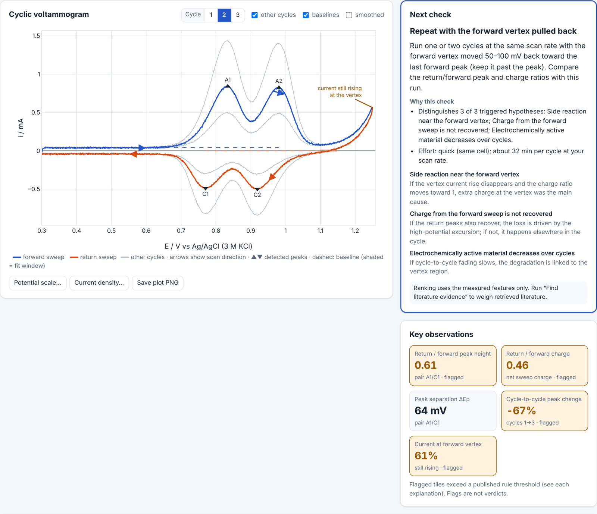

# BenchCheck

> **BenchCheck turns a confusing electrochemical experiment into measured observations, traceable evidence, and a clearer next step.**

BenchCheck helps undergraduate and graduate researchers answer one question about a cyclic voltammogram (CV):

**"What does my experiment actually show, what could explain it, and what should I check next?"**

Upload a CV → confirm columns and units → BenchCheck measures the peaks → searches Google Scholar through **SerpApi** → retrieves accessible paper text through SerpApi's **Extract API** → compares each paper's conditions with yours → proposes the next measurement or metadata check that best separates the competing explanations.



*Synthetic example data: a two-step insertion electrode model scanned to 1.25 V. The forward (blue) and return (orange) sweeps, scan-direction arrows, detected peaks, and baselines are drawn from BenchCheck's own measurements.*

---

## Contents

- [What it does](#what-it-does)
- [Quick start](#quick-start)
- [How SerpApi is used](#how-serpapi-is-used)
- [Scientific approach](#scientific-approach)
- [Credibility rules](#credibility-rules)
- [Architecture](#architecture)
- [Synthetic examples](#synthetic-examples)
- [Evaluation](#evaluation)
- [Project status](#project-status)
- [Limitations](#limitations)
- [Configuration](#configuration)
- [Security](#security)
- [Hackathon notes](#hackathon-notes)
- [Future work](#future-work)

## What it does

| Step | What BenchCheck does |
|---|---|
| **Upload** | Reads CSV/TXT exports (comma, semicolon, tab, whitespace; decimal commas; instrument preambles; units rows). Records the file's SHA-256. |
| **Confirm** | Suggests potential/current/time columns and units from headers or data patterns. **You confirm them**, plus the current sign convention (IUPAC or US). |
| **Describe** | Electrode material, electrolyte, solvent, reference electrode, scan rate, concentration or mass, area, temperature, pH. Missing fields are flagged with *why they matter*. |
| **Measure** | Scan reversals, sweeps and cycles; peak potentials and heights; FWHM; ΔEp and midpoint for candidate pairs; return/forward peak-height and charge ratios; Nicholson ratio for dissolved species; vertex behavior; cycle-to-cycle trends; data-quality flags (clipping, scan-rate mismatch, sign convention, noise, coarse steps). |
| **Hypothesize** | Rule-based hypotheses, each triggered only by a measured feature with a published threshold and explicit assumptions. No mechanism is assigned to any peak. |
| **Search** | Builds Google Scholar queries from your conditions and the flagged features, retrieves results via SerpApi, extracts abstracts or full text via SerpApi Extract, and quotes matching passages **verbatim**. |
| **Compare** | For every source: same/related/different material, electrolyte, solvent, reference electrode and scan-rate regime, and what that means for applicability. |
| **Recommend** | Ranks next checks by how many triggered hypotheses they distinguish, how many have condition-matched literature, and effort. The reasons are shown. |
| **Export** | Report with three separated parts: **Observed**, **Possible explanations**, **Next check** (Markdown, HTML, JSON). |

## Quick start

Requirements: Python 3.10+ (developed on 3.13). No Node build step; Plotly.js is vendored.

```bash
git clone https://github.com/Electrochemistry-Undergrads/BenchCheck.git
cd BenchCheck
python -m venv .venv && source .venv/bin/activate     # Windows: .venv\Scripts\activate
pip install -r requirements.txt
cp .env.example .env                                   # then put your SerpApi key in .env
python -m benchcheck                                   # http://127.0.0.1:8000
```

Click **Synthetic CV · weak return peak**, then **Confirm & analyze**, then **Find literature evidence**.

Without a key, the numerical analysis works fully and the evidence panel explains that evidence is unavailable (or shows previously retrieved, cached evidence, labeled as cached).

Run the checks:

```bash
pip install -r requirements-dev.txt
python -m pytest              # 84 tests
python scripts/evaluate.py    # predefined cases → docs/evaluation_results.md
```

Record real SerpApi evidence for the offline fallback demo (uses up to 3 searches + 5 Extract pages per example):

```bash
python scripts/refresh_demo_cache.py --dry-run   # show the planned queries, no credits used
python scripts/refresh_demo_cache.py             # writes data/cache/demo/ and docs/demo_reports/
BENCHCHECK_EVIDENCE_MODE=cache python -m benchcheck   # serve only cached evidence (labeled cached)
```

## How SerpApi is used

SerpApi is the evidence engine: without it, every explanation is labeled *assumption-based*. With it, explanations carry cited passages, evidence levels and condition comparisons, and the next-check ranking changes.

1. **Google Scholar API** (`engine=google_scholar`). For each analysis BenchCheck plans up to 3 queries:
   - a *context* query from your material, electrolyte and solvent (e.g. `LiMn2O4 LiCl aqueous cyclic voltammetry`),
   - one query per triggered hypothesis, specialized to your conditions (e.g. `LiMn2O4 aqueous LiCl oxygen evolution side reaction`, `LiMn2O4 aqueous LiCl manganese dissolution`).
   Results from all queries are deduplicated; each keeps the queries that found it.
2. **Extract API** (`engine=extract`, `include_markdown=true`). The most relevant results (returned by several queries, same material, snippet matches) are fetched as page text. BenchCheck classifies what it got:
   - **full text**: ≥2000 words and headings for at least three of introduction, methods, results, discussion, conclusion; the references section is excluded before quoting;
   - **abstract**: an Abstract section, or `citation_abstract` / `dc.description` / `description` metadata, or JSON-LD abstract;
   - **search snippet**: only Google Scholar's excerpt is available. Snippets are never presented as full-paper evidence.
3. **Evidence linking.** For each hypothesis, BenchCheck picks the best 1–2-sentence passage per source by term matching (plus your material and salt), verifies it is a verbatim substring of the retrieved text, and highlights the matched terms.
4. **Condition comparison.** Material family, electrolyte salt and concentration, aqueous vs non-aqueous, reference electrode family, and scan-rate regime (within 3×) are extracted with the same dictionaries for your metadata and for the paper text. Unstated conditions are reported as *not stated in the retrieved text*, never guessed.
5. **Influence on the output.** Each explanation is labeled *condition-matched evidence*, *related evidence*, or *no supporting passage*, with the differing conditions listed as limits. Next checks that target hypotheses with condition-matched literature rank higher.
6. **Evidence log drawer.** Every SerpApi call with its query or URL, status (live / cached / error / unavailable), retrieval time (UTC), SerpApi search ID, Google Scholar page link, result count, content classification, and credits used.
7. **Failures and cache.** API errors never block the numerical analysis. Live responses are stored verbatim in `data/cache/` with their retrieval time; reuse is always labeled *cached* with the original retrieval time. The cache is written only from live SerpApi responses.

Credit use per analysis: up to 3 Scholar searches + 5 Extract pages (configurable).

## Scientific approach

Everything numerical is deterministic code (NumPy/SciPy), validated against theory (see [Evaluation](#evaluation)).

- **Sweeps and cycles.** Scan reversals are found with a hysteresis ("zigzag") rule: a reversal counts only after the potential moves back by more than 5% of the window, so noise and staircase plateaus don't create vertices. A *cycle* is the k-th sweep in the forward direction plus the following return sweep; the forward direction is auto-detected from the first full-range sweep or set by the user. Cycle 2 is analyzed by default (cycle 1 often reflects conditioning); any cycle can be selected.
- **Peaks.** Located on a Savitzky–Golay-smoothed copy (≈10 mV window, order 2, within each sweep; adjustable or off). Only peaks of the sign expected for the sweep are reported. Detection requires prominence ≥ max(6σ noise, 3% of the cycle's current range) and width ≥ 5 mV.
- **Baselines.** Default: flat baseline = mean current over 50 mV just before the first wave (three leading half-widths before the first peak); the return sweep uses the forward peak's half-width to place its window. Options: linear pre-wave fit, or no baseline. The fit window is drawn on the plot.
- **Pairs.** Forward and return peaks are paired by order-preserving matching (not by mechanism). Reported: ΔEp, midpoint potential, peak-height ratio, width ratio, and for dissolved species Nicholson's ratio, (i<sub>pr</sub>)<sub>0</sub>/i<sub>pf</sub> + 0.485 (i<sub>sp</sub>)<sub>0</sub>/i<sub>pf</sub> + 0.086 (Nicholson, *Anal. Chem.* 1966, 38, 1406).
- **Charge balance.** Net charge per sweep from the time column, or from the entered scan rate (stated as a constant-rate assumption).
- **Conversions need confirmation.** Reference-scale conversion (SHE or RHE from tabulated values at 25 °C, or a custom offset) and area normalization apply only after an explicit confirmation dialog, and are recorded in the processing log and report.
- **Hypothesis rules** (thresholds shown in the app): side reaction near the forward vertex; charge not recovered; EC-type chemical step (dissolved species); progressive degradation or fouling; kinetic/iR limitation; asymmetric return; truncated return; reference uncertainty; concentration/area vs Randles–Ševčík (only if you enter concentration, area, D and n).

## Credibility rules

- Every explanation links to the measured feature that triggered it, plus explicit assumptions and any cited passages.
- No invented papers, quotations, conditions, numbers or certainty scores. Passages are verbatim excerpts, checked against the retrieved text.
- Evidence level is always visible (full text, abstract, search snippet).
- Condition differences are shown with their consequence, e.g. *"Potentials reported vs Li/Li⁺; yours vs Ag/AgCl. Compare peak positions only after an explicit, confirmed conversion."*
- Mechanistic interpretations are phrased as hypotheses; when evidence is missing the report says so and still gives a practical next check.
- Synthetic data are labeled SYNTHETIC in the file, the UI and every exported report.

## Architecture

```
web/ (vanilla JS + Plotly)                   benchcheck/ (FastAPI, Python)
┌────────────────────────────┐   /api/inspect   ┌─────────────────────────────────────────────┐
│ upload · mapping · metadata │ ───────────────▶ │ cv/parsing        CSV detection, suggestions│
│ CV plot · key stats         │   /api/analyze   │ cv/segmentation   reversals, sweeps, cycles │
│ evidence table · report     │ ───────────────▶ │ cv/peaks, cv/analysis  peaks, baselines,    │
│ evidence log drawer         │                  │                   ratios, charge, quality   │
│                             │ /api/evidence/*  │ reasoning/hypotheses  rules + query plan    │
│ orchestrates: search ×N →   │ ───────────────▶ │ evidence/serpapi  Scholar + Extract + cache │──▶ SerpApi
│ select → extract ×K →       │                  │ evidence/sources  levels, passages          │
│ report                      │   /api/report    │ evidence/conditions  condition comparison   │
│                             │ ───────────────▶ │ reasoning/checks, report  ranking + export  │
└────────────────────────────┘                  └─────────────────────────────────────────────┘
```

- The browser orchestrates the evidence steps so each SerpApi call shows live progress and fails independently.
- The server is stateless; the SerpApi key exists only in the server's environment.
- `benchcheck/evidence/pipeline.py` runs the same orchestration server-side for scripts.

## Synthetic examples

`examples/` contains two **synthetic** CVs generated by `scripts/make_examples.py` with `benchcheck/synth/thinfilm.py`: a two-site Butler–Volmer thin-film model with double-layer current, loosely inspired by a two-step insertion electrode such as LiMn₂O₄ in aqueous LiCl. Peak positions and currents are illustrative, not measured or fitted to any paper. See [examples/README.md](examples/README.md).

| Example | Window | What the generator adds | What BenchCheck should find |
|---|---|---|---|
| `synthetic_lmo_clear_return` | 0.30 → 1.10 V | nothing extra (tiny loss) | ratios ≈ 1, no rule triggered |
| `synthetic_lmo_weak_return` | 0.30 → 1.25 V | anodic side current and loss of the oxidized state above ≈1.15 V | weak return peaks, charge imbalance, rising vertex current, fading |

Each example has a `.meta.json` with explicit metadata (some fields deliberately missing), generator parameters, and ground truth computed from the model's Faradaic component.

## Evaluation

`python scripts/evaluate.py` runs predefined cases with known answers and writes [docs/evaluation_results.md](docs/evaluation_results.md). Current results (all numbers computed by the script): **16 of 16 automated checks pass.** Highlights:

| Check | BenchCheck | Expected |
|---|---|---|
| Reversible diffusion peak current (simulated, 100 mV/s) | −0.42% vs Randles–Ševčík | within ±2% |
| Reversible ΔEp / Nicholson ratio | 57.0 mV / 1.015 | ≈57 mV / 1.00 |
| Surface-confined peak current / FWHM | −0.93% / 89.9 mV | F v Q/4RT / 90.6 mV |
| log i<sub>p</sub> vs log v slope (diffusion) | 0.500 | 0.5 |
| Hypotheses on the two examples | exactly the generator's mechanisms | — |
| Units/format/sign/mid-window/noise robustness | 4 of 4 pass | — |

Known bias, measured rather than hidden: return/forward peak-height ratios read **+3–4% high** on the clear example and **+9–10% high** on the weak example relative to the generator's Faradaic ground truth (sloping backgrounds in the baseline window). Details and the evidence-audit procedure are in [docs/EVALUATION.md](docs/EVALUATION.md).

## Project status

**Works and tested:**
- Parsing, unit handling, segmentation, peak/baseline/ratio/charge calculations: unit and integration tests plus validation against theory.
- Hypothesis rules and next-check ranking: tested on both examples against ground truth.
- Report export (Markdown, HTML, JSON).
- SerpApi client, cache, error handling, evidence classification and condition comparison: tested offline with clearly labeled, schema-shaped fixtures (`tests/fixtures/`).
- Web UI flow on desktop and phone widths: checked with Playwright, including the unavailable-evidence path and both confirmation dialogs.

**Implemented but not yet exercised against the live API:** the SerpApi Google Scholar and Extract calls. The build environment blocked `serpapi.com` and had no key. The Extract API launched on 2026-10-13; its parser follows the documented fields (`page_information`, `meta_tags`, `text_content.full/markdown`) and is written defensively. **First step with a key: run `scripts/refresh_demo_cache.py` and review `docs/demo_reports/`.**

**Not done yet:**
- `data/cache/demo/` is empty until the refresh script is run, so the offline fallback demo has no cached evidence yet.
- The human audit of whether cited passages support each statement (procedure in docs/EVALUATION.md).

## Limitations

- Peak heights depend on the baseline; sloping backgrounds (side reactions, diffusion tails) bias simple baselines. For dissolved species, prefer the Nicholson ratio.
- Overlapping peaks are measured on a common baseline; widths are reported as unresolved rather than deconvoluted.
- Only peaks of the expected sign per sweep are detected (e.g. anodic peaks on negative-going sweeps in some electrocatalysis CVs are not reported).
- Hypothesis rules are a curated, finite set for common CV problems; they cannot cover every mechanism.
- Passage matching is lexical: a passage that *mentions* a phenomenon is not proof it *explains your data*. That is why evidence levels, condition matches and limits are shown, and why human review is recommended.
- Literature access is limited to what Google Scholar indexes and what pages expose to the Extract API (paywalled papers usually yield abstracts only).
- Tabulated reference-electrode offsets are approximate (25 °C); Li/Li⁺ and other non-aqueous scales are not converted.

## Configuration

| Variable | Default | Meaning |
|---|---|---|
| `SERPAPI_API_KEY` | — | SerpApi key (server-side only; read from env or `.env`) |
| `BENCHCHECK_EVIDENCE_MODE` | `auto` | `auto`: live if a key exists, else cache only · `live` · `cache`: never call SerpApi |
| `BENCHCHECK_MAX_QUERIES` | `3` | Scholar searches per analysis |
| `BENCHCHECK_MAX_EXTRACTS` | `5` | Extract pages per analysis |
| `BENCHCHECK_CACHE_DIR` | `data/cache` | Cache root (`live/` is git-ignored, `demo/` is committed) |
| `BENCHCHECK_SERPAPI_TIMEOUT` | `40` | Seconds per SerpApi request |

## Security

- The SerpApi key is read only on the server. It is never sent to the browser, never written to the cache (requests are stored without it, and any echo is redacted), and kept out of logs (httpx request logging is silenced). `.env` is git-ignored.
- The server never fetches arbitrary URLs itself; page retrieval goes through SerpApi.
- All retrieved text is escaped before rendering; only http(s) links are rendered.

## Hackathon notes

- Built for HackTX 2026, targeting the **Best Use of SerpApi** track. All code in this repository was written from scratch starting 2026-10-24 (see the commit history); verify the timing against the official HackTX hacking-period rules. Third-party libraries: FastAPI, NumPy, SciPy, httpx, Uvicorn, Plotly.js (vendored, MIT).
- Built with AI assistance (Claude Code). Check the official HackTX rules for any disclosure requirements.

## Future work

- Charge/discharge (galvanostatic) and EIS analysis using the same Observed → Explanations → Next check structure.
- An ICP-OES dilution-chain checker for dissolution measurements (aliquot/final volumes, back-calculation).
- Scan-rate series upload with automatic b-value and ratio-vs-rate analysis to close the loop on the recommended check.
- Optional SerpApi Google Scholar Cite lookups for formatted citations in exports.
